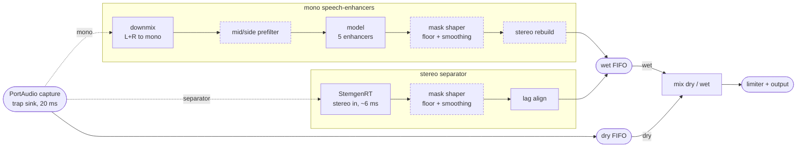

<p align="center">
  
  <h1 align="center">Music Assassin Live</h1>
</p>

<p align="center">
  <a href="https://github.com/mAbEngineers/music-assassin-live/releases/latest"></a>
  <a href="https://github.com/mAbEngineers/music-assassin-live/releases"></a>
  <a href="LICENSE"></a>
  <a href="#requirements"></a>
</p>

<p align="center">
  <strong>Remove background music from any audio your computer plays, live, offline, on CPU only.</strong><br>
  A system-wide realtime background-music remover for Linux and Windows. One toggle, and <em>everything</em> the device plays (browser, YouTube, VLC, Spotify) gets background music stripped before it reaches the speaker, keeping the speech.
</p>

<p align="center">
  <a href="docs/ARCHITECTURE.md">Documentation</a> |
  <a href="https://github.com/mAbEngineers/Music-Assassin">Research repo</a> |
  <a href="https://github.com/mAbEngineers/music-assassin-live/releases">Releases</a> |
  <a href="https://github.com/mAbEngineers/music-assassin-live/issues">Issues</a>
</p>

> **Two-repo project.** Models are trained and benchmarked in the sibling
> research repo, [**Music-Assassin**](https://github.com/mAbEngineers/Music-Assassin)
> — this repo, **Music Assassin Live**, is the shippable app built on top of
> it: routing, streaming engine, UI, packaging.

## What is this?

Music Assassin Live is a free, open-source (MIT) **realtime background music
remover**. It sits between your apps and your speakers, so you do not process
files or upload anything: videos, streams, podcasts, calls and games play
normally, minus the background music. It runs **fully offline**, needs **no
GPU** (ONNX Runtime on the CPU, with OpenVINO acceleration when available),
and has no account, subscription or cloud service.

Use it to remove background music from YouTube, streams, lectures,
documentaries and other speech-first content so dialogue is easier to hear,
or to cut distracting music for focus, accessibility, or listening-fatigue
reasons.

| You want | Use |
|---|---|
| Remove music from whatever is playing right now, system-wide | **Music Assassin Live** (this repo) |
| Remove music from a long video file in one batch | [Music-Assassin](https://github.com/mAbEngineers/Music-Assassin) (sibling repo) |

**Install:** grab the Windows `.exe` or Ubuntu/Debian `.deb` from the
[latest release](https://github.com/mAbEngineers/music-assassin-live/releases/latest).
See [Packaging](#packaging) for the Windows (VB-CABLE) and Linux
(`libportaudio2`) notes.

## Contents

[What is this?](#what-is-this) · [Features](#features) · [How it works](#how-it-works) · [Quick start](#quick-start) ·
[Model library](#model-library) · [Measuring quality](#measuring-quality) ·
[Packaging](#packaging) · [Status](#status) · [Acknowledgments](#acknowledgments)

## Features

- **One toggle, every app** — browser, Spotify, VLC, whatever's playing. No per-app setup, no manual audio routing.
- **PipeWire-native** — routes with `pw-cli` / `wpctl` / `pw-dump` only; no `pactl` dependency.
- **Crash-safe** — quitting, crashing, or killing the process restores your original default sink; `--recover` cleans up stale state at startup.
- **A real model library** — five interchangeable ONNX models behind one processor interface, from a 2 MB speech-enhancer up to a realtime vocal/music separator. See [Model library](#model-library).
- **Mid/side stereo pre-filter** — an optional, model-independent lever that targets wide (non-centered) content using stereo panning instead of spectral guessing. Stacks with any model.
- **Benchmarked, not vibes-based** — `bench_quality.py` scores every model/filter/mix combination against ground-truth stems on a dozen+ metrics — suppression, vocal damage, artifacts, latency — so a change shows up as a number moving, not a feeling.
- **Lightweight** — no torch; the whole Python stack is ≈100 MB.
- **One `.deb`** — models included, `apt install` and go.

## How it works

```
apps (browser, VLC, Spotify…)
   │   WirePlumber migrates all default-following streams
   ▼
"Music Assassin" trap sink  (null sink, set as default while ON)
   │   monitor capture
   ▼
streaming engine: 20 ms blocks → ONNX model → speaker
```

Turning OFF (or quitting, or crashing — recovery runs at startup) restores
the previous default sink.

<details>
<summary><strong>Full pipeline ▸</strong> mono speech-enhancer lane vs. stereo separator lane, FIFOs, optional stages</summary>

Picking a model picks the lane: speech-enhancers (`gtcrn`, `dpdfnet`,
`dtln`, `dpdfnet_hr`, `speechdenoiser`) run mono and can optionally rebuild
a stereo image afterward; `stemgen` runs stereo throughout. Every model's
output is also band-limited to 20 Hz-20 kHz (left off the diagram to keep
it small). Dashed boxes are off by default. Evolution of this diagram:
`docs/PIPELINE_HISTORY.md`.



</details>

## Requirements

- Linux with PipeWire + WirePlumber (tested: PipeWire 1.0.5, Ubuntu 24.04)
- Python 3.10+
- `pip install -r requirements.txt` (numpy, sounddevice, soxr, onnxruntime)

## Quick start

```bash
python -m venv .venv && .venv/bin/pip install -r requirements.txt

# one-time: copy models from the research repo (until release assets exist)
.venv/bin/python scripts/import_models.py --source ../Music-Assassin/models

# run
.venv/bin/python -m assassin_live                             # GUI toggle window
.venv/bin/python -m assassin_live --headless                  # terminal mode, Ctrl-C stops
.venv/bin/python -m assassin_live --headless --model stemgen  # try the realtime separator
.venv/bin/python -m assassin_live --recover                   # cleanup after a crash
```

<details>
<summary>Sanity checks & benchmarking</summary>

```bash
# no audio hardware needed
.venv/bin/python tests/test_processors_offline.py
.venv/bin/python tests/test_routing_dry.py

# plumbing + quality regression check — rerun any time models or code change.
# Falls back to PipeWire's dummy sink with no hardware (clearly marked as
# skipped); add real speakers/headphones to also test the live audio path.
.venv/bin/python tests/test_live_e2e.py

# quantitative de-musicing quality: builds ground-truth vocal/music stems
# with an offline separator (once), then scores any model/filter/mix
# combo against them. No audio hardware needed, same answer every run.
.venv/bin/python tests/bench_quality.py --build-refs your_clip.wav
.venv/bin/python tests/bench_quality.py --sweep model=dpdfnet_hr,gtcrn,dtln,stemgen \
                                        --sweep midside=off,on
```

See [Measuring quality](#measuring-quality) for what each reported number means.
</details>

## Model library

| model | type | rate | latency | RTF | verdict |
|---|---|---|---|---|---|
| **`dpdfnet_hr`** | speech enhancement | 48 kHz | 50 ms | 0.32 | Best overall music suppression of the enhancers; also the most damaging to the voice |
| **`stemgen`** — default | realtime source separation | 44.1 kHz | ~6 ms | 0.09 | First true vocal/music separator in the lineup — keeps voice & stereo image intact; leaves more music audible than `dpdfnet_hr` |
| `dtln` | speech enhancement | 16 kHz | 24 ms | 0.07 | Gentlest on vocals of the enhancers, and the lightest |
| `gtcrn` | speech enhancement | 16 kHz | 16 ms | 0.09 | Smallest (2 MB) and fastest; deletes everything above 8 kHz |
| `dpdfnet` | speech enhancement | 16 kHz | 50 ms | 0.15 | 16 kHz baseline; barely beats doing nothing (+0.20 dSI-SDR) and has the worst artifacts — not recommended |
| `speechdenoiser` | speech enhancement | 48 kHz | — | — | Keeps spoken dialogue clear; upstream licence unresolved, so it's excluded from `.deb` builds |

Four of the five are **speech-enhancement** models: they classify audio by
how speech-like it sounds, which is why every one of them struggles with
singing — a sung vocal reads spectrally closer to "music" than spoken
dialogue does.

`stemgen` (StemgenRT) is different: a causal, block-synchronous **vocal/music
separator**, light enough for the 20 ms live budget, and the first model
here built for actual music removal rather than noise suppression. It isn't
a clean win yet — its leftover music is audible, and its training data
(MUSDB18-HQ, MoisesDB) carries a non-commercial licence that the maintainer
has chosen to accept for now (see `models/README.md`). Pick your model with
`--model <name>` or the GUI picker; full head-to-head numbers are below.

The **mid/side stereo pre-filter** (`assassin_live/audio/midside.py`, toggle
in the GUI or `--midside`) is a complementary, non-model lever for the same
problem: lead vocals are almost always mixed dead-center and instrumental
backing is mixed wide, so attenuating by the mid/side energy ratio per STFT
bin directly targets exactly the content models misclassify. Off by
default; stacks with whichever model is selected.

## Measuring quality

Every claim above has numbers behind it. `tests/bench_quality.py` scores any
combination of model, filter and mix setting against known-correct audio —
no sound hardware, same answer every run.

**How it knows the right answer.** An offline separator splits your own
music into a *vocals* track and a *music* track, then the harness recombines
them at a chosen ratio — so it knows exactly what perfect output would be
(the vocals track) and exactly what should have disappeared (the music
track).

<details>
<summary><strong>Full benchmark methodology, metric glossary, and results ▸</strong></summary>

**Four things every number is compared against:**

| reference point | what it is |
|---|---|
| **do nothing** | the untouched mix — every "improvement" is measured from here |
| **this app** | the real chain in 20 ms blocks, exactly as it runs live |
| **offline separator** | the same separator with unlimited time and no realtime constraints |
| **theoretical best** | perfect knowledge of both tracks — cheating by construction, and unreachable |

Where a config falls on that ladder is what makes a bad score actionable.
Well short of the offline separator means **the realtime path** is the
limit — the one thing this repo can fix directly. Offline separator well
short of the theoretical best means **the model** is the limit. And when
even the theoretical best does badly, that song is simply hard: voice and
instruments occupy the same frequencies at the same moments, and no amount
of engineering wins there.

### What gets measured

Deliberately many numbers rather than one score, because they pull against
each other — suppression is trivially bought by wrecking the vocal, and any
"quality" number is winnable by adding delay.

| reported as | what it tells you | better is |
|---|---|---|
| **music** | how much backing music is left, measured only in the moments the singer is silent | more negative |
| **vocal** | how much of the voice survived, measured on the voice alone | closer to 0 |
| **per-band vocal damage** | *where* the voice got damaged: sub, low, mid, high, air | closer to 0 |
| **dSI-SDR** | overall improvement over doing nothing, immune to plain volume changes | higher — but see caveat below |
| **SIR** | how much of the music the output rejected | higher |
| **SAR** | freedom from *invented* sound — musical noise, warbling, "watery" | higher |
| **musNoise** | added sparkly/robotic artifacts no energy measurement can see | lower — but see caveat below |
| **pumping** | whether attenuation holds steady or breathes in and out | lower |
| **leak bursts** | worst-case / longest run of music breaking through | lower / shorter |
| **clicks** | digital glitches at block edges | lower |
| **stereo** | how much of the stereo image survived | 0 = intact, see note below |
| **lat ms** | delay you actually hear, including model buffering | under ~120 ms, or lip-sync breaks |
| **RTF** | share of the 20 ms per-block CPU budget used | under ~0.8, with room for spikes |
| **alignment sensitivity** | whether the streaming path quietly loses state at block edges | judge against other models, not zero |

Three come with a catch:
- **dSI-SDR weights music removal above keeping the voice** — the opposite
  of this project's priority. Use it to rank candidates, not to decide
  between them.
- **A very low musNoise is not automatically good.** A spectrum hollowed out
  by high-frequency loss scores low too — exactly why `gtcrn` posts the best
  number below while cutting everything above 8 kHz.
- **0 stereo width is not the target.** Stereo spread that lived in the
  bands the model removed is supposed to leave with them.

### How the shipped models score

All five bundled models, whole corpus: 117 clips at two music levels, 234
song/ratio pairs, references built with htdemucs. `music` and `vocal` are in
dB; latency is what you hear, not what the model claims. `RTF` and latency
come from the same desktop (Ryzen 9 9950X3D), measured one model at a time.

| model | music removed | vocal kept | dSI-SDR | SIR | SAR | musNoise | lat | RTF |
|---|---|---|---|---|---|---|---|---|
| **`stemgen`** (default) | −22.2 | **−0.05** | **+7.89** | 16.0 | **9.63** | −8.05 | **5.8 ms** | 0.09 |
| `dpdfnet_hr` | **−41.1** | −3.0 | +6.13 | **26.6** | 6.42 | −2.65 | 50 ms | 0.32 |
| `dtln` | −21.1 | −0.9 | +4.29 | 18.4 | 5.03 | −0.90 | 24 ms | **0.07** |
| `gtcrn` | −26.8 | −2.3 | +3.34 | 11.5 | 5.05 | −14.5 | 16 ms | 0.09 |
| `dpdfnet` (16 kHz baseline) | −49.1 | −2.2 | +0.20 | 24.4 | 1.11 | +5.00 | 50 ms | 0.15 |
| *do nothing* | 0.0 | n/a | 0.0 | −1.6 | 63.1 | 0.0 | 0 ms | n/a |
| *offline separator (ceiling)* | −33.6 | n/a | +19.1 | 31.4 | 19.2 | n/a | n/a | n/a |
| *ideal mask (oracle)* | −48.4 | n/a | +16.5 | 27.3 | 15.7 | n/a | n/a | n/a |

Read across rather than down. `stemgen` is the only model that leaves the
voice alone (−0.05 dB) and the only one that keeps the stereo image, and it
posts the best dSI-SDR and artifact score. What it gives up is music: it
leaves about −22 dB behind, against `dpdfnet_hr`'s −41 dB. `dpdfnet_hr`
removes the most music of the usable models but pays for it in voice damage
and artifacts. `dtln` is the lightest and gentlest of the enhancers but
leaves as much music as `stemgen` while damaging more of the voice. `dpdfnet`
(the 16 kHz baseline) barely beats doing nothing (+0.20 dSI-SDR) despite the
deepest raw suppression, and is not recommended.

Where the voice damage lands, same run:

| model | sub | low | mid | high | air |
|---|---|---|---|---|---|
| `stemgen` | −0.2 | 0.0 | 0.0 | 0.0 | 0.0 |
| `dpdfnet_hr` | −3.5 | −2.7 | −4.0 | −5.6 | −6.1 |
| `dtln` | −1.5 | −0.7 | −1.1 | −1.5 | −56.4 |
| `gtcrn` | −2.3 | −2.1 | −2.7 | −2.5 | −59.5 |
| `dpdfnet` | −2.2 | −1.9 | −2.9 | −2.7 | −63.6 |

The air column is the giveaway: the three 16 kHz models delete everything
above 8 kHz *by construction*, trading breath and presence for lighter CPU
cost. `dpdfnet_hr` keeps the top octave but damages the voice steadily more
the higher you go. `stemgen` leaves every band essentially untouched.
`speechdenoiser` is not in this comparison; it has only ever been judged by
ear.

Which model wins also depends on the material (dSI-SDR in dB, higher is
better; shipped `stemgen`):

| material | `stemgen` | `dpdfnet_hr` | `dtln` |
|---|---|---|---|
| male-lead songs (16 pairs) | **9.94** | 0.33 | 1.07 |
| anime openings (60 pairs) | **11.28** | 4.10 | 3.77 |
| nasheed (130 pairs) | 5.69 | **7.68** | 4.86 |

On nasheed, `dpdfnet_hr` wins and removes about twice as much music, so
`--model dpdfnet_hr` is worth trying for that kind of content. Full
measurements, including larger-hop and int8 variants of `stemgen`, are in
`docs/STEMGEN_HOP_RESULTS.md`. Neither model wins outright: the trade-off
between a clean voice and less leftover music is a listening call, not a
settled score.

### Named failures, counted per song

Averages hide the worst case — a defect that ruins one song in ten is
exactly what a mean is designed to bury. Each song is tagged instead, and
tags are counted rather than averaged.

| tag | what it means | fires above |
|---|---|---|
| `music-leak` / `leak-burst` / `long-burst` | music passing through — on average, in bursts, or one long stretch | −6 dB / −3 dB / 400 ms |
| `vocal-loss` | the voice got pulled down | −4 dB |
| `hf-loss` / `hf-loss-4k` | 8–20 kHz or 4–8 kHz destroyed | −12 dB |
| `artifacts` | output contains sound from neither the voice nor the music | SAR under 3 dB |
| `musical-noise` | sparkly, robotic artifacts added | kurtosis rise over 15 |
| `pumping` | attenuation breathing in and out | 9 dB of unsteadiness |
| `clicks` | sample-level glitches | 200 000 |
| `stereo-collapse` | image flattened | −20 dB |
| `boundary-sensitive` | unusually sensitive to where block edges fall | −12 dB (compare peers, not zero) |
| `latency` / `cpu-risk` | beyond lip-sync tolerance / little realtime headroom | 120 ms / 0.8 RTF |

How often each fired, out of 234 pairs (the most telling tags; the full
list is in the benchmark report):

| tag | `stemgen` | `dpdfnet_hr` | `dtln` | `gtcrn` | `dpdfnet` |
|---|---|---|---|---|---|
| `vocal-loss` | **0** | 46 | 6 | 42 | 36 |
| `hf-loss` | **0** | 38 | 234 | 234 | 234 |
| `artifacts` | **15** | 56 | 80 | 72 | 139 |
| `music-leak` | 26 | 3 | 11 | 7 | 2 |
| `leak-burst` | 69 | 13 | 35 | 7 | 4 |
| `long-burst` | 64 | 73 | 26 | 25 | 45 |
| `pumping` | 93 | 105 | 80 | 116 | 69 |
| `musical-noise` | 45 | 49 | 52 | 28 | 70 |
| `boundary-sensitive` | 61 | 9 | 92 | 24 | 32 |
| `stereo-collapse` | **4** | 234 | 234 | 234 | 234 |

The tags tell `stemgen`'s story: no vocal-loss, no high-frequency loss,
almost no artifacts, but the most leaks (`leak-burst` 69 and `music-leak`
26). `stereo-collapse` fires on every pair for the four enhancers because they
are mono-only and the stereo rebuild was off in this run (the default); it
would improve with the rebuild on. `stemgen` processes both channels itself
and keeps the image. Note how tag counts and averages can disagree: `gtcrn` posts the best
musNoise average (−14.5) while still tripping `pumping` on half the pairs.
That's the reason both are reported.

### Trusting the numbers

Configs that no other config beats on *every* axis at once are marked `*` in
the report — nothing is collapsed into a single ranking, because there's no
defensible exchange rate between "1 dB more music removed" and "40 ms more
delay".

Corpus choice matters as much as the metrics: vary genre, arrangement
density, vocal loudness, dry versus reverberant, speech versus singing, and
stereo placement — a **mono** source makes every mid/side result
meaningless, since there's no stereo information to exploit.

Most importantly: every quality finding in this project so far has needed
confirmation by ear, and two of them contradicted a perfectly plausible
number. `--dump-audio` writes the processed audio out for exactly that
reason. **The numbers rank candidates and show direction; they do not settle
quality.**

</details>

## Packaging

```bash
scripts/build_deb.sh    # -> dist/music-assassin-live_<version>_<arch>.deb
sudo apt install dist/music-assassin-live_*.deb
```

Builds a onefile PyInstaller binary (bundles onnxruntime + tkinter) into a
minimal `.deb` with a desktop entry. Depends on `libportaudio2` (apt pulls
it in automatically — sounddevice looks it up via the system library cache
at runtime, so it must be a real installed package, not just embedded in
the binary).

The five openly-licensed models (`gtcrn`, `dpdfnet`, `dpdfnet_hr`, `dtln`,
`stemgen`) are bundled into `/usr/share/music-assassin-live/models` at
build time and picked up automatically — `apt install` and go, no manual
step. `speechdenoiser` is excluded (its upstream licence is unresolved, see
`models/README.md`); add it yourself in
`~/.local/share/music-assassin/models/` if you want it.

**Windows.** Releases ship an unsigned installer
(`music-assassin-live-setup-<version>.exe`); SmartScreen will show
"Windows protected your PC" because there is no code-signing certificate yet.
Routing uses the free VB-CABLE virtual audio device. Setup offers to download
and install it (checksum-verified, not bundled), and Windows needs a reboot
afterwards. Known open issue: some sessions crash after a while; the app
restores your speakers on every exit and writes a report to
`%USERPROFILE%\.local\state\music-assassin\crash.log`. Build scripts:
`scripts/build_windows.bat`, `.github/workflows/windows-build.yml`; backend:
`assassin_live/audio/backends/windows.py`.

Mobile packaging is still not possible; see `docs/ARCHITECTURE.md` §6
(Platform Reality Check).

## Status

- [x] Layer 1 — PipeWire trap-sink routing, crash recovery, hotplug watch
- [x] Layer 2 — streaming engine (dry-fallback, click-free toggle)
- [x] Layer 3 — GTCRN / DPDFNet / SpeechDenoiser processors (offline-tested)
- [x] Realtime vocal/music separator (StemgenRT) — selectable, bundled; `stemgen` is the default
- [x] Layer 4 — minimal toggle GUI + headless mode
- [x] Live end-to-end validation on real playback (BT sink; injected noise
      removed from output, speech passes, clean sink restore on exit)
- [ ] Tray icon, autostart, first-run model download
- [x] `.deb` packaging (`scripts/build_deb.sh`) — models bundled, ready to run after install
- [ ] PyInstaller → AppImage packaging
- [ ] Native LADSPA port (see `docs/ARCHITECTURE.md` Phase 3)

Models arrive as ONNX release assets — see `docs/ARCHITECTURE.md` §3 for the
contract between this repo and the research repo.

## FAQ

**Does it work offline, without a GPU?** Yes. Everything runs locally on the
CPU; nothing is uploaded.

**How is this different from Ultimate Vocal Remover, Demucs or Spleeter?**
Those separate stems from files after the fact. Music Assassin Live works
on live playback, system-wide, in 20 ms blocks.

**How is this different from noise suppression (RNNoise, DeepFilterNet, Krisp)?**
Those target noise. This targets background music under speech, using
speech-enhancement and music-separation models (see
[Model library](#model-library)).

**Does it remove music from a video file?** Use the sibling repo,
[Music-Assassin](https://github.com/mAbEngineers/Music-Assassin).

## Acknowledgments

The model library wraps ONNX exports of other people's research. Full
license terms and redistribution status live in `models/README.md`; credit
where it's due:

- [**GTCRN**](https://github.com/Xiaobin-Rong/gtcrn) (MIT) — Xiaobin-Rong
- [**DPDFNet / DPDFNet-HR**](https://huggingface.co/Ceva-IP/DPDFNet) (Apache-2.0) — Ceva-IP
- [**DTLN**](https://github.com/breizhn/DTLN) (MIT) — breizhn
- [**StemgenRT**](https://github.com/sweetspotsoundsystem/stemgen-rt) (MIT) — sweetspotsoundsystem, descended from lucidrains' [HS-TasNet](https://arxiv.org/abs/2402.17701)
- [**SpeechDenoiser**](https://github.com/yuyun2000/SpeechDenoiser) — yuyun2000 (dev-only; upstream license unresolved, not bundled in releases)

## License

MIT — see [LICENSE](LICENSE).
