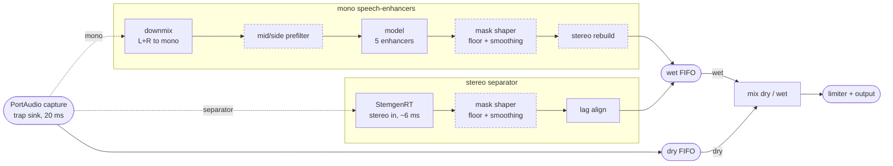

<p align="center">
  
</p>

<h1 align="center">Music Assassin Live</h1>

<p align="center">
  <a href="https://github.com/mAbEngineers/music-assassin-live/releases/latest"></a>
  <a href="https://github.com/mAbEngineers/music-assassin-live/releases"></a>
  <a href="LICENSE"></a>
  <a href="#requirements"></a>
</p>

<p align="center">
  <strong>System-wide, realtime music removal for Linux — works like a volume booster.</strong><br>
  One toggle, and <em>everything</em> the device plays gets background music stripped before it reaches the speaker.
</p>

<p align="center">
  <a href="docs/ARCHITECTURE.md">Documentation</a> |
  <a href="https://github.com/mAbEngineers/Music-Assassin">Research repo</a> |
  <a href="https://github.com/mAbEngineers/music-assassin-live/releases">Releases</a> |
  <a href="https://github.com/mAbEngineers/music-assassin-live/issues">Issues</a>
</p>

> **Two-repo project.** Models are trained and benchmarked in the sibling
> research repo, [**Music-Assassin**](https://github.com/mAbEngineers/Music-Assassin)
> — this repo, **Music Assassin Live**, is the shippable app built on top of
> it: routing, streaming engine, UI, packaging.

## Contents

[Features](#features) · [How it works](#how-it-works) · [Quick start](#quick-start) ·
[Model library](#model-library) · [Measuring quality](#measuring-quality) ·
[Packaging](#packaging) · [Status](#status) · [Acknowledgments](#acknowledgments)

## Features

- **One toggle, every app** — browser, Spotify, VLC, whatever's playing. No per-app setup, no manual audio routing.
- **PipeWire-native** — routes with `pw-cli` / `wpctl` / `pw-dump` only; no `pactl` dependency.
- **Crash-safe** — quitting, crashing, or killing the process restores your original default sink; `--recover` cleans up stale state at startup.
- **A real model library** — five interchangeable ONNX models behind one processor interface, from a 2 MB speech-enhancer up to a realtime vocal/music separator. See [Model library](#model-library).
- **Mid/side stereo pre-filter** — an optional, model-independent lever that targets wide (non-centered) content using stereo panning instead of spectral guessing. Stacks with any model.
- **Benchmarked, not vibes-based** — `bench_quality.py` scores every model/filter/mix combination against ground-truth stems on a dozen+ metrics — suppression, vocal damage, artifacts, latency — so a change shows up as a number moving, not a feeling.
- **Lightweight** — no torch; the whole Python stack is ≈100 MB.
- **One `.deb`** — models included, `apt install` and go.

## How it works

```
apps (browser, VLC, Spotify…)
   │   WirePlumber migrates all default-following streams
   ▼
"Music Assassin" trap sink  (null sink, set as default while ON)
   │   monitor capture
   ▼
streaming engine: 20 ms blocks → ONNX model → speaker
```

Turning OFF (or quitting, or crashing — recovery runs at startup) restores
the previous default sink.

<details>
<summary><strong>Full pipeline ▸</strong> mono speech-enhancer lane vs. stereo separator lane, FIFOs, optional stages</summary>

Picking a model picks the lane: speech-enhancers (`gtcrn`, `dpdfnet`,
`dtln`, `dpdfnet_hr`, `speechdenoiser`) run mono and can optionally rebuild
a stereo image afterward; `stemgen` runs stereo throughout. Every model's
output is also band-limited to 20 Hz-20 kHz (left off the diagram to keep
it small). Dashed boxes are off by default. Evolution of this diagram:
`docs/PIPELINE_HISTORY.md`.



</details>

## Requirements

- Linux with PipeWire + WirePlumber (tested: PipeWire 1.0.5, Ubuntu 24.04)
- Python 3.10+
- `pip install -r requirements.txt` (numpy, sounddevice, soxr, onnxruntime)

## Quick start

```bash
python -m venv .venv && .venv/bin/pip install -r requirements.txt

# one-time: copy models from the research repo (until release assets exist)
.venv/bin/python scripts/import_models.py --source ../Music-Assassin/models

# run
.venv/bin/python -m assassin_live                             # GUI toggle window
.venv/bin/python -m assassin_live --headless                  # terminal mode, Ctrl-C stops
.venv/bin/python -m assassin_live --headless --model stemgen  # try the realtime separator
.venv/bin/python -m assassin_live --recover                   # cleanup after a crash
```

<details>
<summary>Sanity checks & benchmarking</summary>

```bash
# no audio hardware needed
.venv/bin/python tests/test_processors_offline.py
.venv/bin/python tests/test_routing_dry.py

# plumbing + quality regression check — rerun any time models or code change.
# Falls back to PipeWire's dummy sink with no hardware (clearly marked as
# skipped); add real speakers/headphones to also test the live audio path.
.venv/bin/python tests/test_live_e2e.py

# quantitative de-musicing quality: builds ground-truth vocal/music stems
# with an offline separator (once), then scores any model/filter/mix
# combo against them. No audio hardware needed, same answer every run.
.venv/bin/python tests/bench_quality.py --build-refs your_clip.wav
.venv/bin/python tests/bench_quality.py --sweep model=dpdfnet_hr,gtcrn,dtln,stemgen \
                                        --sweep midside=off,on
```

See [Measuring quality](#measuring-quality) for what each reported number means.
</details>

## Model library

| model | type | rate | latency | RTF | verdict |
|---|---|---|---|---|---|
| **`dpdfnet_hr`** — default | speech enhancement | 48 kHz | 50 ms | 0.32 | Best overall music suppression of the enhancers; also the most damaging to the voice |
| **`stemgen`** — new | realtime source separation | 44.1 kHz | ~6 ms | 0.09 | First true vocal/music separator in the lineup — keeps voice & stereo image intact; leaves more music audible than `dpdfnet_hr` |
| `dtln` | speech enhancement | 16 kHz | 24 ms | 0.07 | Gentlest on vocals of the enhancers, and the lightest |
| `gtcrn` | speech enhancement | 16 kHz | 16 ms | 0.09 | Smallest (2 MB) and fastest; deletes everything above 8 kHz |
| `dpdfnet` | speech enhancement | 16 kHz | 50 ms | 0.15 | 16 kHz baseline; benchmarks show it's actively harmful — not recommended |
| `speechdenoiser` | speech enhancement | 48 kHz | — | — | Keeps spoken dialogue clear; upstream licence unresolved, so it's excluded from `.deb` builds |

Four of the five are **speech-enhancement** models: they classify audio by
how speech-like it sounds, which is why every one of them struggles with
singing — a sung vocal reads spectrally closer to "music" than spoken
dialogue does.

`stemgen` (StemgenRT) is different: a causal, block-synchronous **vocal/music
separator**, light enough for the 20 ms live budget, and the first model
here built for actual music removal rather than noise suppression. It isn't
a clean win yet — its leftover music is audible, and its training data
(MUSDB18-HQ, MoisesDB) carries a non-commercial licence that the maintainer
has chosen to accept for now (see `models/README.md`). Pick your model with
`--model <name>` or the GUI picker; full head-to-head numbers are below.

The **mid/side stereo pre-filter** (`assassin_live/audio/midside.py`, toggle
in the GUI or `--midside`) is a complementary, non-model lever for the same
problem: lead vocals are almost always mixed dead-center and instrumental
backing is mixed wide, so attenuating by the mid/side energy ratio per STFT
bin directly targets exactly the content models misclassify. Off by
default; stacks with whichever model is selected.

## Measuring quality

Every claim above has numbers behind it. `tests/bench_quality.py` scores any
combination of model, filter and mix setting against known-correct audio —
no sound hardware, same answer every run.

**How it knows the right answer.** An offline separator splits your own
music into a *vocals* track and a *music* track, then the harness recombines
them at a chosen ratio — so it knows exactly what perfect output would be
(the vocals track) and exactly what should have disappeared (the music
track).

<details>
<summary><strong>Full benchmark methodology, metric glossary, and results ▸</strong></summary>

**Four things every number is compared against:**

| reference point | what it is |
|---|---|
| **do nothing** | the untouched mix — every "improvement" is measured from here |
| **this app** | the real chain in 20 ms blocks, exactly as it runs live |
| **offline separator** | the same separator with unlimited time and no realtime constraints |
| **theoretical best** | perfect knowledge of both tracks — cheating by construction, and unreachable |

Where a config falls on that ladder is what makes a bad score actionable.
Well short of the offline separator means **the realtime path** is the
limit — the one thing this repo can fix directly. Offline separator well
short of the theoretical best means **the model** is the limit. And when
even the theoretical best does badly, that song is simply hard: voice and
instruments occupy the same frequencies at the same moments, and no amount
of engineering wins there.

### What gets measured

Deliberately many numbers rather than one score, because they pull against
each other — suppression is trivially bought by wrecking the vocal, and any
"quality" number is winnable by adding delay.

| reported as | what it tells you | better is |
|---|---|---|
| **music** | how much backing music is left, measured only in the moments the singer is silent | more negative |
| **vocal** | how much of the voice survived, measured on the voice alone | closer to 0 |
| **per-band vocal damage** | *where* the voice got damaged: sub, low, mid, high, air | closer to 0 |
| **dSI-SDR** | overall improvement over doing nothing, immune to plain volume changes | higher — but see caveat below |
| **SIR** | how much of the music the output rejected | higher |
| **SAR** | freedom from *invented* sound — musical noise, warbling, "watery" | higher |
| **musNoise** | added sparkly/robotic artifacts no energy measurement can see | lower — but see caveat below |
| **pumping** | whether attenuation holds steady or breathes in and out | lower |
| **leak bursts** | worst-case / longest run of music breaking through | lower / shorter |
| **clicks** | digital glitches at block edges | lower |
| **stereo** | how much of the stereo image survived | 0 = intact, see note below |
| **lat ms** | delay you actually hear, including model buffering | under ~120 ms, or lip-sync breaks |
| **RTF** | share of the 20 ms per-block CPU budget used | under ~0.8, with room for spikes |
| **alignment sensitivity** | whether the streaming path quietly loses state at block edges | judge against other models, not zero |

Three come with a catch:
- **dSI-SDR weights music removal above keeping the voice** — the opposite
  of this project's priority. Use it to rank candidates, not to decide
  between them.
- **A very low musNoise is not automatically good.** A spectrum hollowed out
  by high-frequency loss scores low too — exactly why `gtcrn` posts the best
  number below while cutting everything above 8 kHz.
- **0 stereo width is not the target.** Stereo spread that lived in the
  bands the model removed is supposed to leave with them.

### How the shipped models score

Whole corpus, 104 song/ratio pairs, references built with htdemucs. `music`
and `vocal` in dB; latency is what you hear, not what the model claims.

| model | music removed | vocal kept | dSI-SDR | SAR | musNoise | lat | RTF |
|---|---|---|---|---|---|---|---|
| **`dpdfnet_hr`** (default) | **−46.1** | −5.0 | **+4.19** | **4.40** | **1.02** | 50 ms | 0.32 |
| `dtln` | −20.6 | **−0.9** | +3.59 | 4.24 | 3.11 | 24 ms | **0.07** |
| `gtcrn` | −28.1 | −2.3 | +2.64 | 3.59 | −20.0 | **16 ms** | 0.09 |
| `dpdfnet` (16 kHz baseline) | −52.9 | −3.1 | **−0.28** | 0.27 | 7.15 | 50 ms | 0.15 |
| *do nothing* | 0.0 | — | 0.0 | 76.4 | 0.0 | 0 ms | — |
| *offline separator* | −42.5 | — | +24.3 | 22.9 | 25.1 | — | — |
| *theoretical best* | −55.0 | — | +18.1 | 16.9 | −3.0 | — | — |

Read across rather than down. `dpdfnet_hr` wins overall and is the default,
but it's also the *most* damaging to the voice of the four, and its win
comes from removing so much music that the scoring forgives that. `dtln`
barely touches the voice at all (−0.9 dB) and runs ~4.5× lighter, but leaves
more than 25 dB more music behind. `dpdfnet` (the 16 kHz baseline) is
actively harmful — a negative dSI-SDR means worse than not processing at
all — despite the deepest raw suppression number of the four.

Where the voice damage lands, same run:

| model | sub | low | mid | high | air |
|---|---|---|---|---|---|
| `dpdfnet_hr` | −4.8 | −4.4 | −7.0 | −8.6 | −9.1 |
| `dtln` | −1.1 | −0.6 | −1.1 | −1.5 | −59.7 |
| `gtcrn` | −1.8 | −1.8 | −3.0 | −2.9 | −63.4 |
| `dpdfnet` | −2.3 | −2.6 | −4.5 | −3.8 | −70.4 |

The air column is the giveaway: the three 16 kHz models delete everything
above 8 kHz *by construction*, trading breath and presence for lighter CPU
cost. `dpdfnet_hr` keeps the top octave but damages the voice steadily more
the higher you go. `speechdenoiser` is not in this comparison; it has only
ever been judged by ear.

**`stemgen`, on a separate 234-pair corpus:** +7.9 dB dSI-SDR with no
measurable vocal damage and the stereo image intact, against `dpdfnet_hr`'s
+6.1 dB with vocal-loss on 46 clips and a collapsed image — but `stemgen`
leaves roughly −22 dB of music behind versus `dpdfnet_hr`'s −41 dB. Neither
wins outright: `stemgen` keeps the voice and the image, `dpdfnet_hr` removes
more music. That trade-off is a listening call, not a settled score.

### Named failures, counted per song

Averages hide the worst case — a defect that ruins one song in ten is
exactly what a mean is designed to bury. Each song is tagged instead, and
tags are counted rather than averaged.

| tag | what it means | fires above |
|---|---|---|
| `music-leak` / `leak-burst` / `long-burst` | music passing through — on average, in bursts, or one long stretch | −6 dB / −3 dB / 400 ms |
| `vocal-loss` | the voice got pulled down | −4 dB |
| `hf-loss` / `hf-loss-4k` | 8–20 kHz or 4–8 kHz destroyed | −12 dB |
| `artifacts` | output contains sound from neither the voice nor the music | SAR under 3 dB |
| `musical-noise` | sparkly, robotic artifacts added | kurtosis rise over 15 |
| `pumping` | attenuation breathing in and out | 9 dB of unsteadiness |
| `clicks` | sample-level glitches | 200 000 |
| `stereo-collapse` | image flattened | −20 dB |
| `boundary-sensitive` | unusually sensitive to where block edges fall | −12 dB (compare peers, not zero) |
| `latency` / `cpu-risk` | beyond lip-sync tolerance / little realtime headroom | 120 ms / 0.8 RTF |

How often each fired on the run above:

| model | fires most often |
|---|---|
| `dpdfnet_hr` | clicks 57, long-burst 49, pumping 38, artifacts 38, **vocal-loss 36**, hf-loss-4k 30, hf-loss 28, musical-noise 26 |
| `dtln` | **hf-loss 104**, boundary-sensitive 44, artifacts 41, pumping 39, musical-noise 26, long-burst 19, vocal-loss 2 |
| `gtcrn` | **hf-loss 104**, pumping 49, artifacts 47, vocal-loss 18, long-burst 13, musical-noise 2 |
| `dpdfnet` | **hf-loss 104**, **clicks 79**, artifacts 73, musical-noise 40, pumping 28, vocal-loss 22 |

`stereo-collapse` fires 104/104 on all four and isn't a model fault — the
chain emits mono unless the stereo rebuild is on. Note how the tag counts
and averages disagree: `dpdfnet_hr` posts the best musNoise average (1.02)
while still tripping the musical-noise tag on a quarter of the songs. That's
the reason both are reported.

### Trusting the numbers

Configs that no other config beats on *every* axis at once are marked `*` in
the report — nothing is collapsed into a single ranking, because there's no
defensible exchange rate between "1 dB more music removed" and "40 ms more
delay".

Corpus choice matters as much as the metrics: vary genre, arrangement
density, vocal loudness, dry versus reverberant, speech versus singing, and
stereo placement — a **mono** source makes every mid/side result
meaningless, since there's no stereo information to exploit.

Most importantly: every quality finding in this project so far has needed
confirmation by ear, and two of them contradicted a perfectly plausible
number. `--dump-audio` writes the processed audio out for exactly that
reason. **The numbers rank candidates and show direction; they do not settle
quality.**

</details>

## Packaging

```bash
scripts/build_deb.sh    # -> dist/music-assassin-live_<version>_<arch>.deb
sudo apt install dist/music-assassin-live_*.deb
```

Builds a onefile PyInstaller binary (bundles onnxruntime + tkinter) into a
minimal `.deb` with a desktop entry. Depends on `libportaudio2` (apt pulls
it in automatically — sounddevice looks it up via the system library cache
at runtime, so it must be a real installed package, not just embedded in
the binary).

The five openly-licensed models (`gtcrn`, `dpdfnet`, `dpdfnet_hr`, `dtln`,
`stemgen`) are bundled into `/usr/share/music-assassin-live/models` at
build time and picked up automatically — `apt install` and go, no manual
step. `speechdenoiser` is excluded (its upstream licence is unresolved, see
`models/README.md`); add it yourself in
`~/.local/share/music-assassin/models/` if you want it.

Windows builds exist (`scripts/build_windows.bat`, compiled on every push
by `.github/workflows/windows-build.yml`) and the Windows routing backend is
written (`assassin_live/audio/backends/windows.py`): it traps through a
virtual audio cable such as VB-CABLE, which the user installs. What has
**not** happened is an end-to-end run on real Windows hardware — CI runners
have no audio endpoints, so no machine has yet played audio through it.
Treat Windows as untested rather than finished. Mobile packaging is still
not possible — see `docs/ARCHITECTURE.md` §6 (Platform Reality Check).

## Status

- [x] Layer 1 — PipeWire trap-sink routing, crash recovery, hotplug watch
- [x] Layer 2 — streaming engine (dry-fallback, click-free toggle)
- [x] Layer 3 — GTCRN / DPDFNet / SpeechDenoiser processors (offline-tested)
- [x] Realtime vocal/music separator (StemgenRT) — selectable, bundled; `dpdfnet_hr` stays default
- [x] Layer 4 — minimal toggle GUI + headless mode
- [x] Live end-to-end validation on real playback (BT sink; injected noise
      removed from output, speech passes, clean sink restore on exit)
- [ ] Tray icon, autostart, first-run model download
- [x] `.deb` packaging (`scripts/build_deb.sh`) — models bundled, ready to run after install
- [ ] PyInstaller → AppImage packaging
- [ ] Native LADSPA port (see `docs/ARCHITECTURE.md` Phase 3)

Models arrive as ONNX release assets — see `docs/ARCHITECTURE.md` §3 for the
contract between this repo and the research repo.

## Acknowledgments

The model library wraps ONNX exports of other people's research. Full
license terms and redistribution status live in `models/README.md`; credit
where it's due:

- [**GTCRN**](https://github.com/Xiaobin-Rong/gtcrn) (MIT) — Xiaobin-Rong
- [**DPDFNet / DPDFNet-HR**](https://huggingface.co/Ceva-IP/DPDFNet) (Apache-2.0) — Ceva-IP
- [**DTLN**](https://github.com/breizhn/DTLN) (MIT) — breizhn
- [**StemgenRT**](https://github.com/sweetspotsoundsystem/stemgen-rt) (MIT) — sweetspotsoundsystem, descended from lucidrains' [HS-TasNet](https://arxiv.org/abs/2402.17701)
- [**SpeechDenoiser**](https://github.com/yuyun2000/SpeechDenoiser) — yuyun2000 (dev-only; upstream license unresolved, not bundled in releases)

## License

MIT — see [LICENSE](LICENSE).
