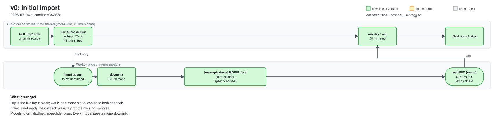
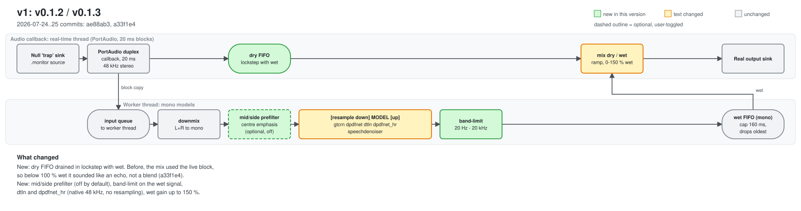
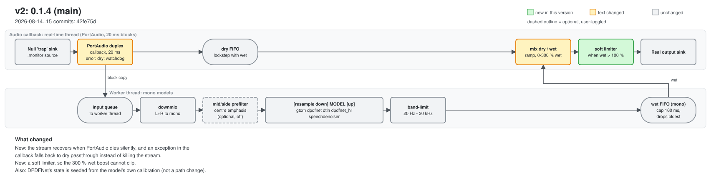
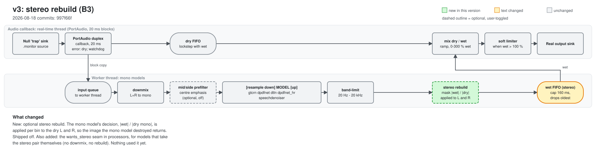
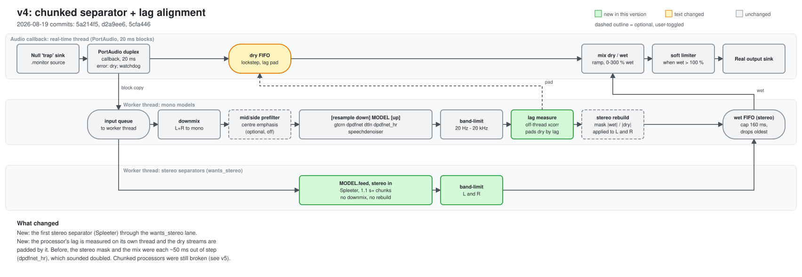
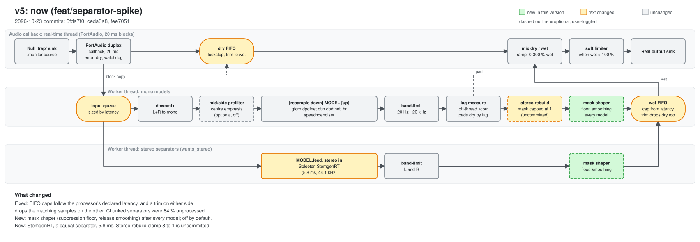

# Pipeline history

One diagram per version where the **audio path** changed. Colours compare each
diagram with the one before it: green = new box, amber = its behaviour
changed, dashed outline = user-toggled. The diagrams are generated by
`python scripts/draw_pipelines.py`. To record a new change, add a delta to
`VERSIONS` there and a section here.

The first lane is the real-time PortAudio callback; the second is the worker
thread that runs the model. From v4 a third lane carries stereo separators.

| Version | Date | In one line |
|---|---|---|
| [v0](#v0--initial-import) | 2026-07-04 | Mono enhancer, wet copied to both channels |
| [v1](#v1--v012--v013) | 2026-07-25 | Dry FIFO, mid/side, band-limit, dtln, dpdfnet_hr |
| [v2](#v2--014-main) | 2026-08-15 | Soft limiter, callback that cannot kill the stream |
| [v3](#v3--stereo-rebuild-b3) | 2026-08-18 | Optional stereo rebuild around a mono model |
| [v4](#v4--chunked-separator--lag-alignment) | 2026-08-19 | First stereo separator, lag measured and padded |
| [v5](#v5--now) | 2026-10-23 | Latency-sized FIFOs, mask shaper, StemgenRT |

## v0 — initial import

2026-07-04, `c34263c`. 

The whole idea: capture the system's audio on a null sink's monitor, run one
mono model, write to the real sink. Models: gtcrn, dpdfnet, speechdenoiser.

## v1 — v0.1.2 / v0.1.3

2026-07-24..25, `ae88ab3` (v0.1.2), `a33f1e4` (v0.1.3). 

- **Dry FIFO:** the mix used to take the live block as dry. The wet signal is
  late by the model's lag, so below 100 % wet it was an echo, not a blend.
  Dry now waits in a FIFO drained by exactly as much as wet.
- **Mid/side prefilter** (off by default) and a **20 Hz–20 kHz band-limit** on
  the wet signal.
- **dtln** and **dpdfnet_hr** (native 48 kHz, so no resampling round trip).

## v2 — 0.1.4 (main)

2026-08-14..15, merged `42fe75d`. 

- A watchdog restarts the stream when PortAudio dies silently.
- An exception in the callback plays dry instead of ending the stream.
- A soft limiter, so the 300 % wet boost cannot clip.

## v3 — stereo rebuild (B3)

2026-08-18, `997f66f`. 

A mono model destroys the stereo image (side energy −161 dB on every pair).
The model's own per-bin decision, `|wet| / |dry mono|`, is applied to the dry
L and R. Shipped off. The same commit adds the `wants_stereo` seam for models
that take the stereo pair themselves.

## v4 — chunked separator + lag alignment

2026-08-19, `5a214f5`, `d2a9ee6`, `5cfa446`. 

- **Spleeter** is the first user of the stereo lane. It answers in whole
  chunks of 1.1 s or more.
- **The processor's lag is measured** (cross-correlation, off the worker's
  critical path) and the dry streams are padded by it. Before this, the
  stereo mask and the mix were each ~50 ms out of step on `dpdfnet_hr`.

## v5 — now

2026-10-23, `6fda7f0`, `ceda3a8`, `fee7051` (the stereo clamp is uncommitted).

- **FIFO caps follow the processor.** They were a fixed 160 ms, so a chunked
  separator came out 84 % unprocessed. A trim on either side now drops the
  matching samples on the other, which keeps dry and wet paired by position.
- **Mask shaper** after every model: a suppression floor and release
  smoothing, powers smoothed so it cannot amplify. Off by default.
- **StemgenRT**, a causal separator at 5.8 ms, through the stereo lane.
- Uncommitted: the stereo rebuild's mask is capped at 1 (was 8).

## Ideas that would change the diagram next

Not built; listed in `docs/RESEARCH_IDEAS.md`. The two that are pipeline
changes: running two models in parallel and blending them, and a cascade
(separator first, enhancer on its output).
